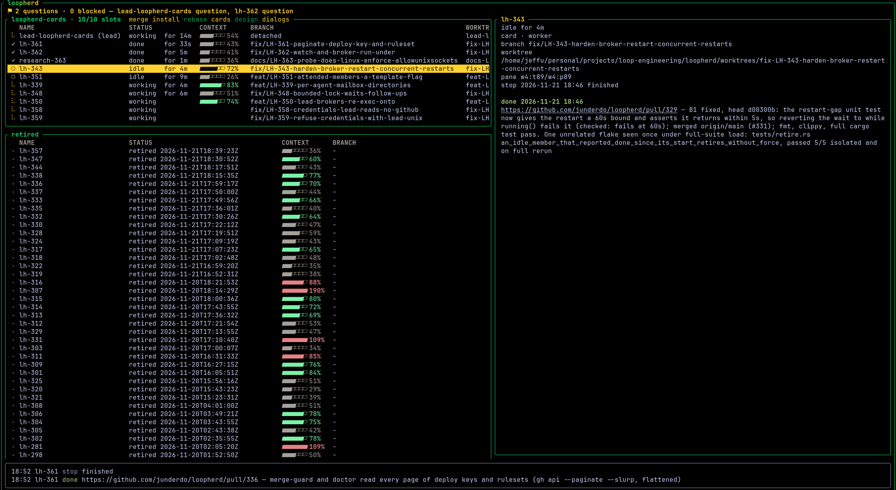

# loopherd


Herd your coding agents. loopherd is a Rust CLI and TUI for Linux and macOS
that groups Claude Code agents into **herds** that run themselves across
sessions and restarts and bring you only what needs a human. It layers on
[herdr](https://herdr.dev/), which runs the terminals and knows whether each
agent is working, blocked, or done.

Coding agents stop when their task does. One waits on a question, one
finished an hour ago with nothing to do next, one died with the last reboot,
and nothing moves until someone notices. loopherd is a human-in-the-loop
harness that gives that job to agents. Each herd has a **lead** that feeds
it tasks from your issue queue, watches its members and checks what they
finish. Above the leads is the **shepherd**, the one agent you talk to. It
starts the leads and brings you only the questions and decisions you've kept
for yourself. The herds run themselves in between.



- **Templates**: declare once how to spawn a member (repo, worktree, prompt),
  then `loopherd add <herd> <template> <params…>`.
- **Queues**: `feed` fills a herd's free slots from a task source, such as
  a repo's `ready-for-agent` issues, and retires members whose work is done.
- **Leads**: a lead member runs a herd's loop unattended, in Claude Code's
  sandbox, within switches you set.
- **Mailbox**: members report to a mailbox, and `watch` wakes you, or
  notifies you, when one needs you.
- **Revival and handoff**: a ledger of each member's task and Claude
  session, so a reboot or closed tab loses nothing, and a member near its
  context limit hands off to a fresh session.
- **One view** of every member across repos, sorted by what needs you.

### New since 0.2.0

- `loopherd update` updates a release or a source install in place.
- The release installer offers what `scripts/install` does: agent types, the
  `mattpocock-skills` plugin, the herdr plugin and its key bindings.
- The view lists each member's running subagents, and `view.layout` (or
  `v` in the view) puts the shepherd beside it or below it.
- The context window comes from each session's model; limits take `250k`
  or `65%`.
- herdr's startup hook always starts alive leads' brokers; `setup` asks
  whether it should also revive members.
- `loopherd gate <sha>` runs a herd's checks for its sandboxed lead,
  outside the sandbox.
- `watch` says when a member has stalled: idle after a paused stop for
  `stalled_after` minutes (30 by default).

## Requirements

- Linux or macOS, x86_64 or aarch64.
- [herdr](https://herdr.dev/), running.
- [Claude Code](https://code.claude.com/docs/en/overview) (`claude`).
- On Linux and WSL2, leads also need [bubblewrap and
  socat](https://code.claude.com/docs/en/sandboxing#set-up-linux-and-wsl2)
  for their sandbox.

## Install

```bash
curl -fsSL https://junderdo.dev/loopherd/install.sh | sh
```

It installs the latest release as `~/.local/bin/loopherd` (put
`~/.local/bin` on `PATH`), adds loopherd's Claude hooks and skill (backing
up `settings.json` first), runs `loopherd setup`, and finishes with
`loopherd doctor`. Pin a release with `LOOPHERD_VERSION=v0.2.0` in front of
`sh`. Update with `loopherd update`.

From source (needs `git`, [Rust](https://rustup.rs/) and
[`jq`](https://jqlang.github.io/jq/download/)):

```bash
git clone https://github.com/junderdo/loopherd.git && cd loopherd && scripts/install
```

To uninstall: `loopherd install-hook --remove` and
`rm ~/.local/bin/loopherd`. Installer flags, the optional herdr plugin and
its key bindings, and the rest are in [docs/install.md](docs/install.md).

## A first herd

With herdr running, in a repo's main checkout:

```bash
cd ~/code/my-app && claude        # accept the trust dialog once, then exit
loopherd init                     # write the herd; it asks for what it can't infer
loopherd feed my-app --dry-run    # list the tasks you expect
loopherd view                     # in a herdr pane; press s to start your shepherd
loopherd lead my-app              # start the lead, which feeds and watches the herd
```

`init` prints the steps it leaves to you: fill each `(fill in)` placeholder
it lists, then review and commit the repo files it added. `loopherd herds`
checks the herd file. Run `loopherd lead` yourself, or ask the shepherd to.

**When you're unsure how to do something, ask your shepherd.** The shepherd
is the Claude session you work in beside the herd. `s` in `loopherd view`
focuses it, or starts one beside the view when there's none; with the herdr
plugin, `prefix+shift+m` opens the view beside it. It reads loopherd's guide
(`loopherd --skill`), so ask it things like "how do I pause a herd?" or "why
didn't feed spawn anything?", and it can run the commands for you.

[docs/setup.md](docs/setup.md) walks these steps with the detail: what
`init` writes, the trust dialog, the lead's sandbox, and writing a herd file
by hand.

## Where to go next

- [docs/install.md](docs/install.md): install paths and flags, updating,
  `setup`, uninstalling, the herdr plugin.
- [docs/setup.md](docs/setup.md): setting up a repo, the lead's sandbox,
  hand-written herd files.
- [docs/tour.md](docs/tour.md): every command, grouped by what it's for.
  `loopherd --help` and `loopherd <command> --help` give every flag.
- `loopherd --skill`: the guide the shepherd and leads follow.
- [docs/wayfinding.md](docs/wayfinding.md): direction, decisions and open
  questions; [docs/research/herdr.md](docs/research/herdr.md): what herdr
  offers; [docs/releasing.md](docs/releasing.md): how releases are cut.

## How it's built

loopherd is also a loop-engineering experiment: much of it is written by
agents pulling cards from the
private [Trello board](https://trello.com/b/MtiTIrp1/loopherd), with tests and lints
as the back-pressure. Agent instructions start at [AGENTS.md](AGENTS.md);
the card workflow is
[docs/agents/issue-tracker.md](docs/agents/issue-tracker.md).

```bash
cargo fmt --check && cargo clippy --all-targets -- -D warnings && cargo test
LOOPHERD_LIVE=1 scripts/herdr-dev cargo test --test live   # against a dev herdr session
scripts/trello help                                        # needs TRELLO_API_KEY / TRELLO_TOKEN
```

## License

GPL-3.0. See [LICENSE](LICENSE).
